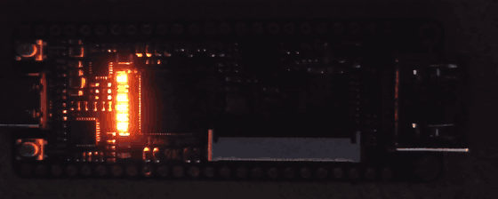
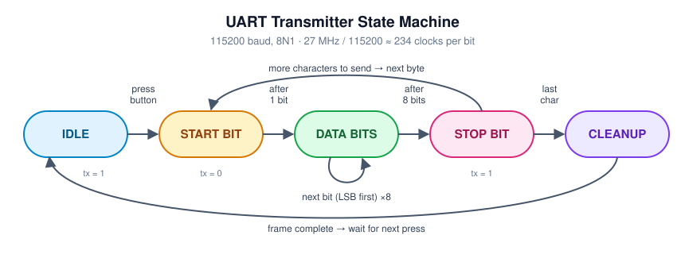
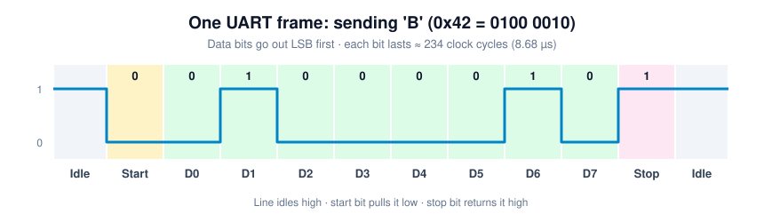
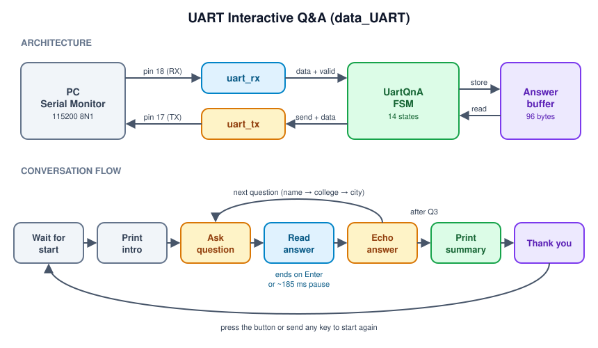

# FPGA Projects: Tang Nano 9K

A step-by-step collection of Verilog projects built on the **Sipeed Tang Nano 9K** (Gowin GW1NR-9) FPGA board. They start with a single logic gate and work up to a full two-way UART design that holds a conversation over the serial monitor.


<p align="center">
  
  <br>
  <em>The 6-bit binary counter running on the Tang Nano 9K</em>
</p>

---

## Table of Contents

- [Hardware](#hardware)
- [Projects at a Glance](#projects-at-a-glance)
- [Project Details](#project-details)
  - [1. AND Gate](#1-and-gate--adder)
  - [2. Running LED](#2-running-led--blink_led)
  - [3. 6-bit Binary Counter](#3-6-bit-binary-counter--counter)
  - [4. Count-to-N Counters](#4-count-to-n-counters--4_bit-counter-8_bit_counter-16_bit_counter)
  - [5. Up/Down Counter](#5-updown-ping-pong-counter--counter_countsback)
  - [6. UART Random Number Transmitter](#6-uart-random-number-transmitter--uartuart)
  - [7. UART Name Transmitter](#7-uart-name-transmitter--uart_name)
  - [8. UART Interactive Q&A](#8-uart-interactive-qa--data_uart)
- [Pin Map](#pin-map)
- [How to Build and Flash](#how-to-build-and-flash)
- [Using the Serial Monitor](#using-the-serial-monitor)
- [Key Concepts Learned](#key-concepts-learned)
- [Repository Structure](#repository-structure)
- [Author](#author)

---

## Hardware

| Item | Details |
|---|---|
| Board | Sipeed Tang Nano 9K |
| FPGA | Gowin GW1NR-9C (`GW1NR-LV9QN88PC6/I5`) |
| Clock | 27 MHz onboard crystal (pin 52) |
| LEDs | 6 onboard LEDs, **active-low** (pins 10, 11, 13, 14, 15, 16) |
| Buttons | 2 onboard push buttons, **active-low** (pins 3 and 4) |
| USB-UART | Onboard BL702 bridge: TX = pin 17, RX = pin 18 |
| Software | Gowin EDA V1.9.11.03 Education |

---

## Projects at a Glance

| # | Project | Folder | What it does | Concepts |
|---|---|---|---|---|
| 1 | AND Gate | `Adder/` | Two buttons drive one LED through an AND gate | Combinational logic, pin constraints |
| 2 | Running LED | `blink_led/` | A single lit LED moves across all 6 LEDs | Clock division, rotate/shift, async reset |
| 3 | 6-bit Counter | `counter/` | Binary count 0–63 on the LEDs | Sequential logic, counters |
| 4 | Count-to-N | `4_bit-counter/`, `8_bit_counter/`, `16_bit_counter/` | Counts 0→4, 0→8 and 0→16, then wraps | Modulo counters, active-low output |
| 5 | Up/Down Counter | `Counter_countsback/` | Counts 0→63, then back down 63→0, forever | Direction control, timing constraints (SDC) |
| 6 | UART Random Numbers | `UART/UART/` | Button press sends a pseudo-random byte as hex text | UART TX FSM, LFSR, edge detection |
| 7 | UART Name | `UART_NAME/` | Button press sends `My name is Bharath` | ROM-style message storage over UART |
| 8 | UART Q&A | `data_UART/` | Asks questions over serial, stores your answers, prints a summary | Full-duplex UART (TX + RX), memory, multi-state FSM |

---

## Project Details

### 1. AND Gate · `Adder/`

**Source:** `src/AND_GATE.v` · **Constraints:** `src/Adder.cst`

The simplest possible design: `y = a & b`.

| Signal | Pin | Board connection |
|---|---|---|
| `a` | 4 | Push button |
| `b` | 3 | Push button |
| `y` | 10 | LED0 |

> **Note:** Both the buttons and the LED are active-low. With neither button pressed, `a = b = 1`, so `y = 1` and the LED is **off**. Pressing **either** button pulls an input to 0, so `y = 0` and the LED turns **on**. This is a good first lesson in how active-low I/O changes the behaviour you see.

---

### 2. Running LED · `blink_led/`

**Source:** `src/LED.v` · **Constraints:** `src/9K_LED_project.cst`

A single lit LED "runs" across the six LEDs, moving one position every **0.5 s**.

- A 24-bit counter counts 13,500,000 cycles of the 27 MHz clock (= 0.5 s).
- When the count is reached, the LED pattern rotates left: `led <= {led[4:0], led[5]}`.
- It starts at `6'b111110`, so exactly one LED is on because the LEDs are active-low.
- The button on **pin 4** is an asynchronous active-low reset (`sys_rst_n`).

The folder also has `src/sipo.v`, a parameterised **serial-in parallel-out shift register** (default width 16), and a `.rao` Gowin Analyzer Oscilloscope configuration for on-chip debugging.

---

### 3. 6-bit Binary Counter · `counter/`

**Source:** `src/count.v` · **Constraints:** `src/counter.cst`

A free-running 6-bit counter that increments every 0.5 s and shows its value on the six LEDs. It counts 0 to 63 and then wraps to 0.

<p align="center">
  
</p>

📹 **Full-quality video:** [`counter/VID20260530185238.mp4`](counter/VID20260530185238.mp4) (stored with Git LFS)

> **Note:** The counter value drives the LEDs directly (`assign led = ledCounter;`). Because the LEDs are active-low, a **lit LED means a 0 bit**. The Count-to-N projects below invert the output so that lit = 1.

---

### 4. Count-to-N Counters · `4_bit-counter/`, `8_bit_counter/`, `16_bit_counter/`

These three designs share the same structure and differ only in where the counter wraps. Each one steps every 0.5 s.

| Folder | Count sequence | Counter width | LEDs used |
|---|---|---|---|
| `4_bit-counter/` | 0 → 4, then back to 0 | 3 bits | LED0–LED2 |
| `8_bit_counter/` | 0 → 8, then back to 0 | 4 bits | LED0–LED3 |
| `16_bit_counter/` | 0 → 16, then back to 0 | 5 bits | LED0–LED4 |

Highlights:
- The output is inverted (`~ledCounter`), so **a lit LED = binary 1**, which is easier to read.
- Unused LEDs are held at `1`, so they stay off.
- The wrap value is checked explicitly (`if (ledCounter == N) ledCounter <= 0;`), which makes these **modulo-(N+1) counters**.

---

### 5. Up/Down (Ping-Pong) Counter · `Counter_countsback/`

**Source:** `src/count_back.v` · **Constraints:** `src/Counter_countsback.cst`, `src/tangnano9k.sdc`

A 6-bit counter that counts **up from 0 to 63**, turns around, counts **down from 63 to 0**, and repeats.

- A `countUp` direction flag flips at each end of the range.
- It steps every 0.5 s.
- It includes an **SDC timing constraint** that tells the tools the clock is 27 MHz (`create_clock -period 37.037`), so timing analysis is meaningful.

---

### 6. UART Random Number Transmitter · `UART/UART/`

**Source:** `src/uart_tx.v` · **Constraints:** `src/UART.cst`

Each press of the trigger button sends a new **pseudo-random 8-bit number** to the PC as two hex characters followed by a newline (for example `B8`, `5C`, `2E` …).

How it works:
1. **Edge detector:** the button press is turned into a single one-clock pulse.
2. **8-bit LFSR:** a linear-feedback shift register (seed `8'b10111000`) produces the next pseudo-random value on every press.
3. **Hex encoder:** each 4-bit nibble is converted to an ASCII character (`'0'–'9'`, `'A'–'F'`).
4. **UART TX state machine:** `IDLE → START → DATA (8 bits, LSB first) → STOP → CLEANUP`, sending three bytes per press (high nibble, low nibble, `\n`).

<p align="center">
  
</p>

Each byte goes out as one 8N1 frame, as in this example:

<p align="center">
  
</p>

| Setting | Value |
|---|---|
| Baud rate | 115200, 8N1 |
| Clocks per bit | 27,000,000 / 115,200 ≈ 234 |
| Trigger button | pin 3 |
| Reset button | pin 4 (active-low) |
| TX | pin 17 → onboard USB-UART |

---

### 7. UART Name Transmitter · `UART_NAME/`

**Source:** `src/name.v` · **Constraints:** `src/UART_NAME.cst`

This uses the same UART transmitter as Project 6, but instead of random numbers it sends a fixed message on every button press:

```
My name is Bharath
```

The 20-byte message (including the newline) is stored in a `case`-based lookup function that works like a small ROM. A character index walks through it one byte at a time.

---

### 8. UART Interactive Q&A · `data_UART/`

**Source:** `src/data_uart.v` · **Constraints:** `src/tangnano9k_3.cst`

The most advanced project here: a **full-duplex UART** design that holds a conversation through the serial monitor.

```
-- Answer the questions --

What is your name? Bharath
What is your college name? <your answer>
Where do you live? <your answer>

----- Summary -----
Name    : Bharath
College : <your answer>
City    : <your answer>

Thank you! Press a key to start again.
```

<p align="center">
  
</p>

Architecture:
- **`uart_tx`:** a reusable 8N1 transmitter module with `send`/`busy` handshaking.
- **`uart_rx`:** a reusable 8N1 receiver module that outputs `data` plus a one-cycle `valid` strobe.
- **`UartQnA` (top):** a 14-state FSM that:
  - prints fixed prompts stored as Verilog string constants,
  - stores each answer in a 96-byte on-chip buffer (up to 31 characters per answer),
  - echoes each answer back, then prints a formatted summary.
- **Line-ending handling:** an answer is complete when **Enter** (CR or LF) is received **or** typing pauses for about 185 ms. That means it works with any serial monitor setting, including "No Line Ending" in the Arduino Serial Monitor.
- Only printable ASCII characters (`0x20`–`0x7E`) are stored.

| Signal | Pin | Function |
|---|---|---|
| `clk` | 52 | 27 MHz clock |
| `rst` | 4 | Reset (active-low) |
| `trig_inv` | 3 | Start / restart (active-low) |
| `tx` | 17 | UART TX → PC |
| `rx` | 18 | UART RX ← PC |

To start a session, press the button on pin 3 **or** send any character from the serial monitor.

---

## Pin Map

Tang Nano 9K pins used across these projects:

| Function | Pin | I/O standard |
|---|---|---|
| 27 MHz clock | 52 | LVCMOS33 |
| LED0 | 10 | LVCMOS18 |
| LED1 | 11 | LVCMOS18 |
| LED2 | 13 | LVCMOS18 |
| LED3 | 14 | LVCMOS18 |
| LED4 | 15 | LVCMOS18 |
| LED5 | 16 | LVCMOS18 |
| Button | 3 | LVCMOS18 |
| Button | 4 | LVCMOS18 |
| UART TX | 17 | LVCMOS33 |
| UART RX | 18 | LVCMOS33 |

---

## How to Build and Flash

### Using Gowin EDA (GUI)

1. Install **Gowin EDA** (the Education edition is free).
2. Clone this repository:
   ```bash
   git clone https://github.com/bharathhottin/FPGA_Projects.git
   ```
   The demo video is stored with Git LFS. Run `git lfs install` before cloning if you want to download it.
3. In Gowin EDA, open a project with **File → Open → `<project>/<project>.gprj`**.
4. Run **Synthesize**, then **Place & Route**.
5. Open **Programmer**, select device `GW1NR-9C`, and load the bitstream from `impl/pnr/<project>.fs`.
   - **SRAM Program:** quick test, lost when the board loses power.
   - **embFlash Erase, Program:** permanent, survives power cycles.

### Using openFPGALoader (command line)

```bash
# Load to SRAM (temporary)
openFPGALoader -b tangnano9k impl/pnr/<project>.fs

# Write to flash (permanent)
openFPGALoader -b tangnano9k -f impl/pnr/<project>.fs
```

---

## Using the Serial Monitor

The UART projects (6, 7 and 8) talk to your PC through the board's onboard USB-serial bridge.

1. Plug the board in over USB and find its COM port in Device Manager. The board may show **two** ports; if you see nothing on one, try the other.
2. Open any serial terminal (Arduino Serial Monitor, PuTTY, Tera Term, VS Code Serial Monitor) with these settings:
   - **Baud:** 115200
   - **Data bits:** 8 · **Parity:** None · **Stop bits:** 1
3. Press the trigger button (pin 3) and watch the output.

---

## Key Concepts Learned

- **Clock division:** turning a 27 MHz clock into human-visible timing. 27,000,000 × 0.5 s = 13,500,000 cycles per step.
- **Active-low I/O:** why `~` appears on LED outputs and why buttons read `0` when pressed.
- **Counters:** free-running, modulo-N and bidirectional designs.
- **Finite state machines:** structured control logic for serial protocols.
- **UART protocol:** start bit, 8 data bits (LSB first), stop bit, and baud-rate generation (27 MHz / 115200 ≈ 234 clocks per bit).
- **Edge detection:** turning a held button into a single-cycle pulse.
- **LFSR:** hardware pseudo-random number generation.
- **On-chip memory:** buffering received UART data and replaying it.
- **Constraints:** physical pin mapping (`.cst`) and timing constraints (`.sdc`).

---

## Repository Structure

```
FPGA_Projects/
├── Adder/                 # AND gate (buttons → LED)
├── blink_led/             # Running LED + SIPO shift register
├── counter/               # 6-bit binary counter + demo video
├── 4_bit-counter/         # Count 0→4
├── 8_bit_counter/         # Count 0→8
├── 16_bit_counter/        # Count 0→16
├── Counter_countsback/    # Up/down ping-pong counter
├── UART/UART/             # UART TX: random hex numbers (LFSR)
├── UART_NAME/             # UART TX: fixed name message
├── data_UART/             # UART TX + RX: interactive Q&A
└── images/                # Demo GIF and diagrams used in this README
```

Each project follows the standard Gowin layout:

```
<project>/
├── <project>.gprj         # Gowin project file (open this in the IDE)
├── src/                   # Verilog sources (.v), pin (.cst) and timing (.sdc) constraints
└── impl/
    ├── gwsynthesis/       # Synthesis reports and netlist
    └── pnr/               # Place & route output, including the .fs bitstream
```

---

## Author

**Bharath** · [@bharathhottin](https://github.com/bharathhottin)

Learning digital design, one LED at a time. ⚡

If you found this useful, consider giving the repo a ⭐!
